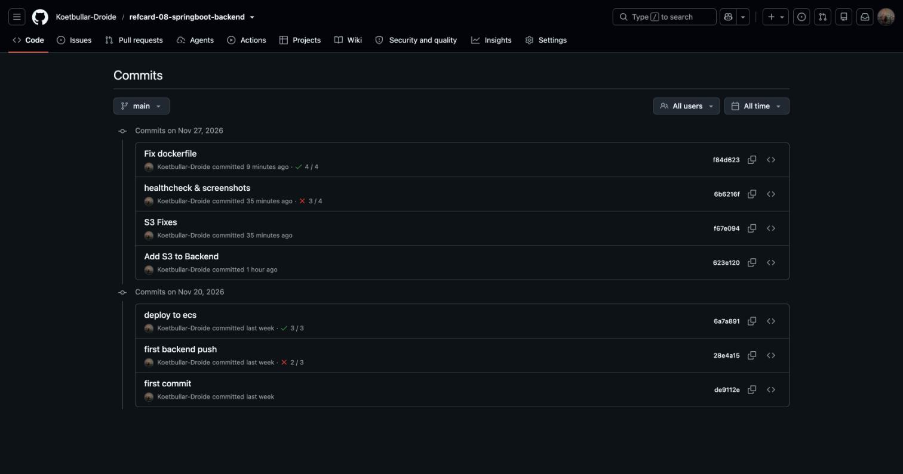
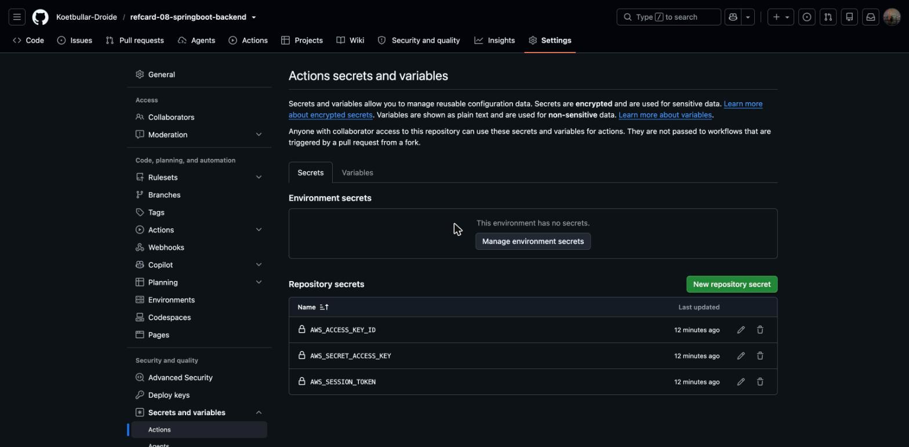
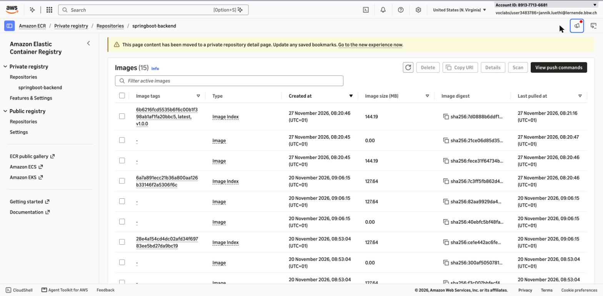
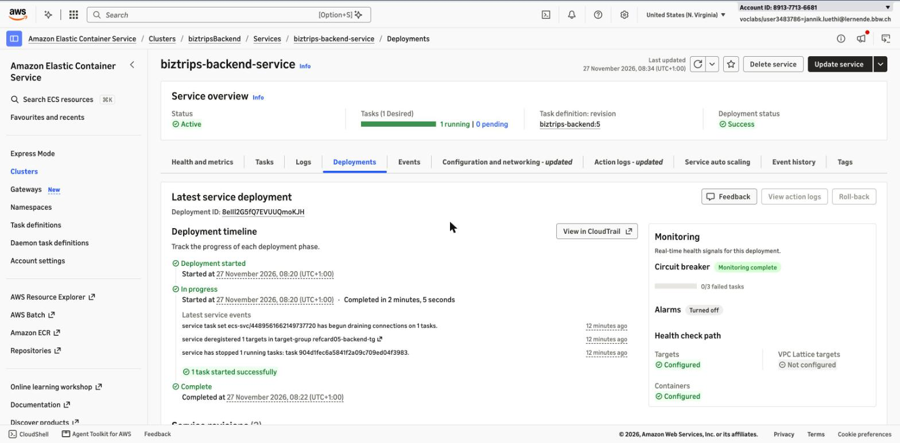
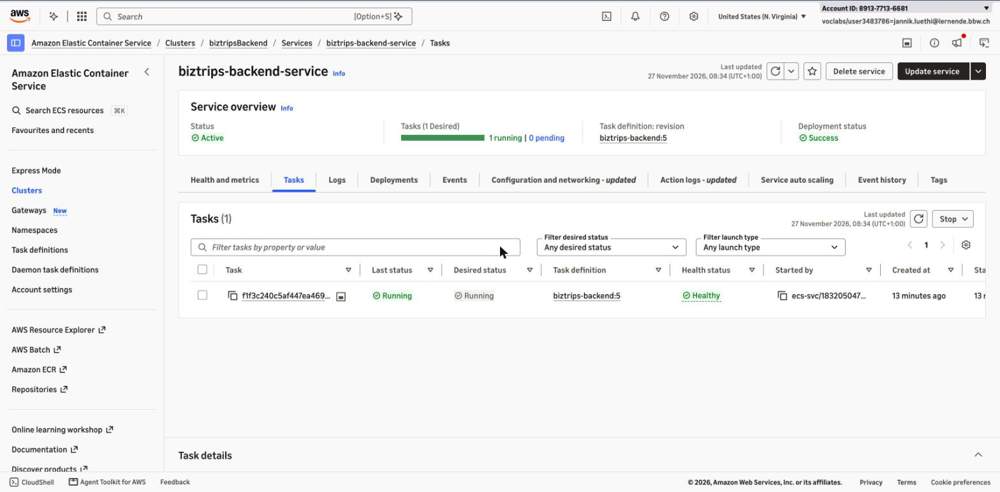

# RefCard 05 – Spring Boot Backend auf AWS (ECR, ECS, RDS)

REST-API-Backend für die BusinessTrips-Applikation (Mitarbeitende, Business
Trips, Flüge, Meetings). Teil der CI/CD-Übungssequenz **RefCard 02–05**
(siehe [`docs/future/RefCard-03-RefCard-05-own-repos.md`](docs/future/RefCard-03-RefCard-05-own-repos.md))
— dieses Repository ist der **Backend-Teil von RefCard 05**: Spring Boot Backend,
als Container auf ECS Fargate, Datenbank auf RDS (MariaDB).

Das Frontend liegt im eigenen Repo
[`refcard-05-react-vite`](https://github.com/Koetbullar-Droide/refcard-05-react-vite),
die lokale Gesamtumgebung (Frontend + Backend + MariaDB) im Ordner `refcard-05-compose`.

## Tech-Stack

- Java 21, Spring Boot 4.1 (Web, Data JPA)
- MariaDB (lokal via Docker Compose) / H2 (Default, für Tests und schnellen lokalen Start)
- Maven (Maven Wrapper, kein lokales Maven nötig)

## Schnellstart

### Ohne Datenbank-Setup (H2, Default)

```bash
./mvnw spring-boot:run
```

Startet auf Port 8080 mit einer flüchtigen In-Memory-H2-Datenbank (Daten sind nach jedem Neustart weg, werden aber automatisch neu geseedet).

### Mit MariaDB (persistent, wie in Produktion)

```bash
docker compose -f docker/docker-compose.yml up -d
./mvnw spring-boot:run -Dspring-boot.run.profiles=mariadb
```

- MariaDB läuft dann auf `localhost:3306` (Datenbank `db_biztrips`, User `root`, Passwort `bbw123`)
- phpMyAdmin ist unter [http://localhost:8082](http://localhost:8082) erreichbar (gleiche Zugangsdaten)
- Die Demo-Daten werden nur beim allerersten Start eingefügt — ein Neustart der Applikation dupliziert sie nicht

### Tests ausführen

```bash
./mvnw test
```

Braucht **JDK 21** (wie CI und Dockerfile). Ab JDK 23 läuft Lombok nicht mehr automatisch und der
Build bricht mit vielen `cannot find symbol`-Fehlern ab. Dann z. B.
`JAVA_HOME=$(/usr/libexec/java_home -v 21) ./mvnw test`.

## API

Basis-Pfad: `/v1`

| Endpoint                                                                                                                                           | Beschreibung                                                              |
| -------------------------------------------------------------------------------------------------------------------------------------------------- | ------------------------------------------------------------------------- |
| `GET /v1/trips`, `POST /v1/trips`, `GET /v1/trips/{id}`, `DELETE /v1/trips/{id}`                                                                   | Business Trips                                                            |
| `GET /v1/employees`, `POST /v1/employees`, `GET /v1/employees/{id}`, `PUT /v1/employees/{id}`, `DELETE /v1/employees/{id}`, `DELETE /v1/employees` | Mitarbeitende                                                             |
| `GET /v1/flights`, `POST /v1/flights`, `GET /v1/flights/{id}`, `PUT /v1/flights/{id}`, `DELETE /v1/flights/{id}`, `DELETE /v1/flights`             | Flüge                                                                     |
| `GET /v1/meetings`, `POST /v1/meetings`, `GET /v1/meetings/{id}`, `PUT /v1/meetings/{id}`, `DELETE /v1/meetings/{id}`, `DELETE /v1/meetings`       | Meetings                                                                  |
| `POST /v1/signIn`                                                                                                                                  | Login (Demo-User: `joe` / `1234`)                                         |
| `GET /v1/images`, `POST /v1/images` (multipart `file`), `GET /v1/images/{key}`, `DELETE /v1/images/{key}`                                       | Bilder (lokal oder S3, siehe unten)                                       |
| `GET /actuator/health`                                                                                                                             | Health-Check (Spring Boot Actuator) — prüft u. a. die Datenbankverbindung |
| `GET /actuator/info`                                                                                                                               | Deployte Version (`app.version` = Git-Tag)                                |

## Deployment auf AWS (RefCard 05)

```
Internet ─► ALB refcard05-backend-alb :80 ─► Target Group (ip, :8080, /actuator/health)
                                              └─► ECS-Service biztrips-backend-service (Fargate)
                                                     ├─► RDS MariaDB springboot-backend :3306
                                                     └─► S3 refcard05-biztrips-images-891377136681/images/*
```

| Ressource             | Name                                                                                                  |
| --------------------- | ----------------------------------------------------------------------------------------------------- |
| ECR-Repository        | `springboot-backend`                                                                                  |
| ECS-Cluster / Service | `biztripsBackend` / `biztrips-backend-service`                                                        |
| Task Definition       | `biztrips-backend` ([`task-definition.json`](task-definition.json))                                   |
| Load Balancer         | `refcard05-backend-alb` → http://refcard05-backend-alb-791071793.us-east-1.elb.amazonaws.com/v1/trips |
| Datenbank             | RDS MariaDB `springboot-backend` (nicht öffentlich, Port 3306 nur aus `refcard05-backend-sg`)         |
| DB-Zugangsdaten       | von RDS verwaltetes Secret in Secrets Manager, ECS liest `username`/`password` daraus                 |

- **Pipeline** ([`.github/workflows/deploy.yml`](.github/workflows/deploy.yml)):
  `version` + `test` → `build` → `deploy-ecs` (Lab-Session prüfen, Image nach ECR, Task Definition rendern,
  ECS-Service rolling aktualisieren, Smoke-Test). `deploy-ecs` läuft bei Push auf `main` und bei Tags `v*.*.*`,
  nicht bei Pull Requests. Maven-Abhängigkeiten werden gecacht.
- **Datenbank `db_biztrips`** legt das Backend beim ersten Start selbst an (`createDatabaseIfNotExist=true`),
  Tabellen über `ddl-auto=update`, Demo-Daten über den Seed in `BusinessTripsBackendApplication`.
- **CORS**: lokal `*`; auf ECS per `APP_CORS_ALLOWED_ORIGINS` auf die Frontend-ALB-URL eingeschränkt.
- **Rollen**: Learner Lab erlaubt keine eigenen IAM-Rollen → `LabRole` als Execution- und Task-Role.
- **Konfiguration nach Umgebung getrennt**: Default-Profil = H2 (Tests), Profil `mariadb` = lokale
  Defaults (`application-mariadb.properties`, nur für Docker Compose). Auf ECS überschreiben
  Umgebungsvariablen aus der Task Definition URL, CORS und Storage, User und Passwort kommen aus
  Secrets Manager. Im Repo stehen keine AWS-Zugangsdaten.

### Versionierung (Git-Tags → Image-Tag in ECR)

Versionen folgen [SemVer](https://semver.org/lang/de/) und werden als Git-Tag gesetzt. Der Job `version`
leitet daraus mit `git describe` den Image-Tag ab:

| Situation | Image-Tag in ECR | Beispiel |
| --- | --- | --- |
| Commit hat einen Release-Tag | `<tag>` | `v1.1.0` |
| Commits nach dem letzten Tag (Push auf `main`) | `<tag>-<anzahl>-g<sha>` | `v1.1.0-2-g3f9c2ab` |
| Noch kein Tag im Repo | `0.0.0-g<sha>` | `0.0.0-g623e120` |

Zusätzlich bekommt jedes Image den vollen Commit-SHA und `latest`. Die Version steckt auch im Image
(Label `org.opencontainers.image.version`) und ist im laufenden Container unter `GET /actuator/info`
abrufbar. So ist jederzeit klar, welcher Commit gerade auf ECS läuft.

Release erstellen:

```bash
git tag -a v1.1.0 -m "S3-Bilder-Storage, Health-Checks"
git push origin v1.1.0        # startet die Pipeline -> Image springboot-backend:v1.1.0
```

Frontend und Backend werden unabhängig versioniert. Welche Versionen zusammengehören, steht in der
Release-Tabelle im Compose-Repo.

### Deployment absichern und überwachen

| Ebene | Mechanismus |
| --- | --- |
| Container | `healthCheck` in [`task-definition.json`](task-definition.json): `GET /actuator/health` alle 30 s, 120 s Startzeit |
| Load Balancer | Target Group prüft `/actuator/health`. Ein Task bekommt erst Traffic, wenn er gesund ist |
| ECS-Service | Rolling Update (min. 100 % / max. 200 %) mit **Circuit Breaker + Rollback**: wird der neue Task nicht gesund, rollt ECS auf die letzte funktionierende Task-Definition zurück |
| Pipeline | `wait-for-service-stability`, danach **Smoke-Test** über den ALB: `/actuator/health` = `UP` und `/actuator/info` meldet genau die neue Version. Sonst wird der Job rot |
| Ressourcen | Fargate 0.5 vCPU / 1 GB RAM (Spring Boot braucht ~350 MB Heap, Puffer für Lastspitzen) |

Abgelaufene Lab-Credentials erkennt der Schritt *Lab-Session prüfen* und bricht mit einer klaren
Fehlermeldung ab, statt erst beim ECR-Login zu scheitern.

### Bilder-Storage: lokal (RefCard 04) → S3 (RefCard 05)

Der Endpoint `/v1/images` spricht nur mit dem Interface `ImageStorage` (`ch.bbw.trips.storage`).
Welche Implementierung aktiv ist, entscheidet `APP_STORAGE_TYPE`:

| `APP_STORAGE_TYPE` | Implementierung | Wo |
| --- | --- | --- |
| `local` (Default) | `LocalImageStorage` | Verzeichnis `APP_STORAGE_LOCAL_DIR` bzw. Docker-Volume (lokal, Compose) |
| `s3` | `S3ImageStorage` | Bucket `APP_STORAGE_S3_BUCKET` unter `images/` (ECS) |

Warum S3 statt Volume auf ECS: Fargate-Tasks haben nur ein flüchtiges Dateisystem. Bei 2 Tasks hätte
jeder seine eigenen Bilder, und bei jedem Deployment wären sie weg. S3 wird von allen Tasks geteilt
und überlebt Deployments.

- **Keine Zugangsdaten im Code**: Der AWS SDK holt sie über die Default Credential Chain, auf ECS
  aus der Task-Rolle `LabRole`.
- **Least Privilege trotz Learner Lab**: Eine eigene Rolle ist nicht möglich. Darum schränkt die
  [Bucket-Policy](scripts/s3-bucket-policy.json) ein: nur `LabRole` darf `images/*` lesen, schreiben
  und löschen, alle anderen Principals (ausser der Lab-Konsole `voclabs`) sind gesperrt, nur HTTPS.
- Bucket ist privat (Block Public Access) und mit SSE-S3 verschlüsselt. Bilder werden über das
  Backend ausgeliefert (`GET /v1/images/{key}`), nicht direkt aus S3.
- Schlüssel generiert der Server (UUID + Endung), Uploads sind auf Bildtypen beschränkt.
- **Fehlerfälle**: Verweigert S3 den Zugriff (403, z. B. falsche Bucket-Policy oder abgelaufene
  Credentials) oder ist S3 nicht erreichbar, antwortet `/v1/images` mit `503` und
  `{"error": "Bilder-Storage nicht verfügbar (S3 PutObject)"}` statt mit einem rohen 500er. Im Log
  (CloudWatch `/ecs/biztrips-backend`) stehen Operation, Objekt und bei 403 der Hinweis auf
  Bucket-Policy und Task-Rolle. Fehlt `APP_STORAGE_S3_BUCKET`, bricht der Start sofort ab.
  Abgedeckt durch `S3ImageStorageTest` und `ImageControllerTest`.

**Was die Least-Privilege-Policy erlaubt** ([`scripts/s3-bucket-policy.json`](scripts/s3-bucket-policy.json)):

| Statement | Wirkung |
| --- | --- |
| `AllowBackendTaskRoleObjectAccess` | `LabRole` (Task-Rolle des Backends): nur `GetObject`, `PutObject`, `DeleteObject` auf `images/*` |
| `AllowBackendTaskRoleListImagesPrefix` | `LabRole`: `ListBucket` nur mit Prefix `images/` |
| `DenyEveryoneElse` | alle anderen Principals werden explizit gesperrt (Ausnahme: `voclabs` = Lab-Konsole, sonst sperrt man sich selbst aus) |
| `DenyInsecureTransport` | Zugriff nur über HTTPS |

Kein `s3:*`, kein Zugriff auf andere Buckets und kein Löschen des Buckets. In einem eigenen
AWS-Account würde man dieselben Rechte als IAM-Policy an eine eigene Task-Rolle hängen statt an `LabRole`.

S3-Variante lokal ausprobieren (nutzt die Lab-Credentials aus `~/.aws`):

```bash
APP_STORAGE_TYPE=s3 APP_STORAGE_S3_BUCKET=refcard05-biztrips-images-891377136681 ./mvnw spring-boot:run
curl -F file=@bild.png http://localhost:8080/v1/images
```

### Learner-Lab-Credentials (statt OIDC)

AWS Academy Learner Lab erlaubt weder `iam:CreateRole` noch eigene OIDC-Provider. Die Pipeline nutzt
deshalb die temporären Lab-Credentials als GitHub Secrets `AWS_ACCESS_KEY_ID`, `AWS_SECRET_ACCESS_KEY`,
`AWS_SESSION_TOKEN`. Diese laufen mit der Lab-Session ab. Nach jedem Lab-Neustart:

1. Werte aus _AWS Details_ → `~/.aws/credentials` kopieren
2. `./scripts/set-aws-secrets.sh` (setzt die Secrets in Backend- **und** Frontend-Repo, braucht `gh`)

Läuft die Session ab, bricht der Pipeline-Schritt *Lab-Session prüfen* mit einer klaren Meldung ab.
Dann Lab neu starten, Schritte 1–2 wiederholen und den fehlgeschlagenen Run mit *Re-run jobs* neu starten.
Die laufenden ECS-Services sind davon nicht betroffen: Sie nutzen `LabRole`, nicht die Secrets.

**Vergleich: Learner Lab vs. produktiver Account (OIDC, wie in EX-03)**

| | Learner Lab (hier) | Produktiv: OIDC |
| --- | --- | --- |
| Anmeldung in der Pipeline | statische Keys aus GitHub Secrets | GitHub stellt pro Run ein OIDC-Token aus, AWS tauscht es gegen kurzlebige Credentials (`role-to-assume`) |
| Gespeicherte Geheimnisse | 3 Secrets pro Repo | keine |
| Gültigkeit | Lab-Session (~4 h), danach manuell erneuern | pro Run, automatisch |
| Einschränkung | jeder mit den Keys hat die vollen `voclabs`-Rechte | Trust-Policy beschränkt auf Repo/Branch (`repo:Koetbullar-Droide/…:ref:refs/heads/main`), Rolle mit minimalen Rechten |
| Risiko bei Leak | Keys bis Sessionende nutzbar | nichts Statisches, das leaken kann |
| Voraussetzung | – | `iam:CreateOpenIDConnectProvider` + `iam:CreateRole` (im Learner Lab gesperrt) |

In einem produktiven Account wäre OIDC klar besser. Die Pipeline müsste dafür nur im Schritt
`configure-aws-credentials` die drei Keys durch `role-to-assume: arn:aws:iam::<account>:role/github-deploy`
ersetzen und `permissions: id-token: write` setzen.

## Nachweise (Screenshots)

| Was | Screenshot |
| --- | --- |
| Commits und Tags |  |
| Pipeline-Run (alle Jobs grün, Version, Smoke-Test) |  |
| GitHub Secrets (Lab-Credentials) |  |
| ECR-Repository mit Versions-Tags |  |
| ECS-Service (Deployment, laufender Task) |  |
| ECS-Task (Container healthy) |  |
| RDS-Instanz |  |
| S3-Bucket mit Bildern |  |
| S3-Bucket-Policy |  |
| API über den ALB (`/actuator/info`, `/v1/trips`) |  |

## Projektstruktur

```
src/main/java/ch/bbw/trips/   Applikationscode (Controller, Entities, Repositories, DTOs)
docker/docker-compose.yml     MariaDB + phpMyAdmin für die lokale Entwicklung
Dockerfile                    Multi-Stage-Build (JDK baut das JAR → JRE-Alpine-Image)
task-definition.json          ECS-Task-Definition (Fargate, RDS, Secrets Manager)
.github/workflows/deploy.yml  CI/CD: test → build → ECR → ECS
src/main/java/ch/bbw/trips/storage/  Bilder-Endpoint + Storage (lokal / S3)
scripts/                      AWS-Setup, S3-Bucket-Policy und Learner-Lab-Secrets
docs/exercises/               CI/CD-Übungen (EX-01 EC2, EX-02 Docker Hub, EX-03 ECS/RDS)
docs/reviews/                 Code-Reviews
docs/future/                  Planungsentscheidungen für RefCard 03–05
```

## Für Studierende

Der Tag [`v1-start`](../../releases/tag/v1-start) markiert den Ausgangspunkt für die Übungen in `docs/exercises/` — bewusst **ohne** `Dockerfile`, `.dockerignore`, `.github/workflows/deploy.yml` und `task-definition.json`, da ihr genau diese Dateien in EX-01/EX-02/EX-03 selbst erstellt.
